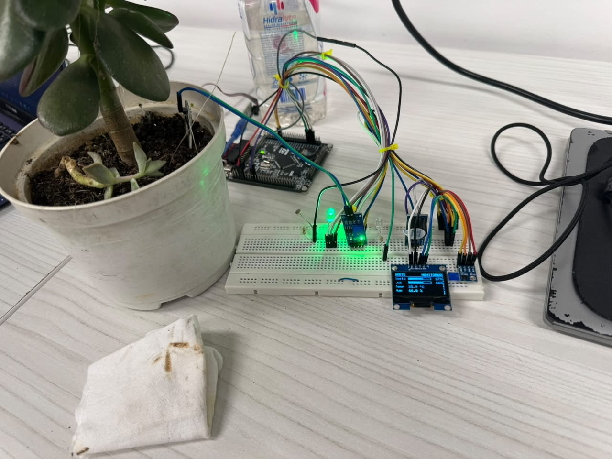
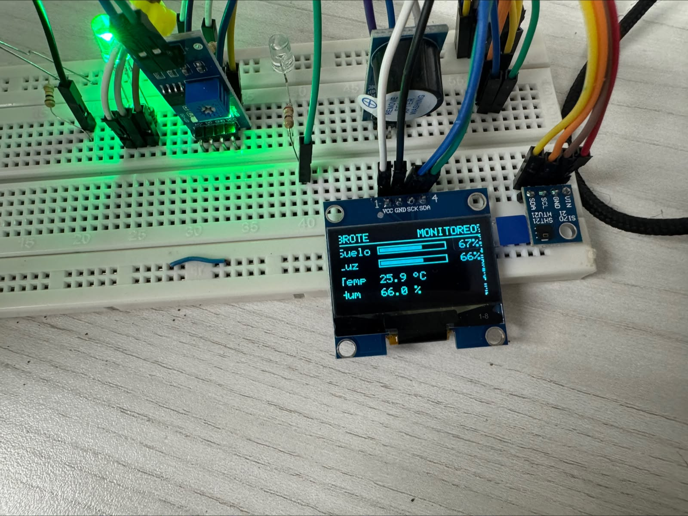

# Brote: mini-invernadero con STM32F407 y FreeRTOS

Mini-invernadero para un pequeño árbol de jade (*Crassula ovata*). Mide la humedad del suelo, la luz y la temperatura y humedad del aire; "riega" solo cuando el suelo está seco, muestra todo en una pantalla OLED, indica el estado con un LED RGB y avisa los fallos con un buzzer.

**Curso:** Microprocesadores, Universidad Pontificia Bolivariana (Reto 4: programación en alto nivel)
**Integrantes:** Gildardo Estevan Restrepo · Marco Aurelio Guardia
**Plataforma:** STM32F407VET6 · HAL de ST · FreeRTOS (CMSIS-RTOS v2) · STM32CubeMX / STM32CubeIDE



## Qué hace

- **Mide** humedad del suelo (sonda YL-69), luz (LDR) y temperatura y humedad del aire (HTU21).
- **Riega** con pulsos de 1 s cuando el suelo baja del 15 % y se detiene al llegar al 35 %. Por presupuesto, la bomba se representa con un LED indicador en PC6.
- **Muestra** las lecturas y el estado en una OLED SSD1306, con tres pantallas que rotan con un botón.
- **Avisa** los fallos (sensor desconectado, riego sin efecto, sobretemperatura) con LED rojo y buzzer, y bloquea el riego.
- **Registra** mensajes y telemetría por UART.



## Cómo funciona

Cinco tareas de FreeRTOS, cada una con una prioridad distinta:

| Tarea | Prioridad | Activación | Qué hace |
|---|---|---|---|
| `tActuators` | High | Notificación desde `tControl` | LED de riego con tiempo máximo, buzzer y LED RGB |
| `tControl` | AboveNormal | Cola `qEvents` | Máquina de estados, umbrales y detección de fallos |
| `tSensors` | Normal | Periódica, 500 ms | Lee ADC y HTU21, valida rangos |
| `tDisplay` | BelowNormal | Periódica, 250 ms | Dibuja la OLED |
| `tLogger` | Low | Cola `qLog` | Único dueño de la UART |

Las tareas se comunican con dos colas (`qEvents`, `qLog`), dos mutex (`mtxI2C` para el bus compartido por la OLED y el HTU21, `mtxData` para el estado compartido) y notificaciones de tarea.

Estados del sistema y cómo se reconocen:

| Estado | LED RGB | Buzzer | LED de riego (PC6) |
|---|---|---|---|
| INIT | Blanco | Un bip | Apagado |
| MONITOREO | Verde | — | Apagado |
| RIEGO | Azul que "respira" | — | Pulsos de 1 s |
| MANUAL | Ámbar | — | Solo al pulsar K1 |
| ALARMA | Rojo parpadeando | Un bip cada 2 s | Apagado y bloqueado |

El diseño completo (justificación de prioridades, diagrama de estados, errores previstos) está en [docs/arquitectura.md](docs/arquitectura.md).

## Hardware y conexiones

| Componente | Pin | Función |
|---|---|---|
| Sensor de suelo YL-69 (salida AO) | PC0 | ADC1_IN10, con pull-down de 100 kΩ |
| LDR (divisor con 10 kΩ) | PC1 | ADC1_IN11 |
| HTU21 y OLED SSD1306 | PB6 (SCL) / PB7 (SDA) | I2C1, bus compartido |
| LED de riego (con 220 Ω) | PC6 | GPIO, activo en alto |
| Módulo buzzer | PC7 | GPIO, activo en alto, alimentado a 3V3 |
| LED RGB (220 Ω por canal) | PD12 / PD13 / PD14 | TIM4 PWM |
| Botones de la placa | PE4 (K0) · PE3 (K1) · PA0 (K_UP) | Interrupciones externas |
| UART de telemetría | PA9 (TX) / PA10 (RX) | USART1, 115200 8N1 |

Tabla completa en [docs/propuesta.md](docs/propuesta.md), diagrama de armado en [docs/cableado.md](docs/cableado.md) y lista de materiales en [docs/bom.md](docs/bom.md).

## Cómo compilar y cargar

1. Abrir STM32CubeIDE y elegir **File → Open Projects from File System…**, con la carpeta `firmware/brote`.
2. **Project → Build** (configuración Debug).
3. Conectar la sonda de depuración por SWD (PA13 / PA14) y lanzar con clic derecho sobre el proyecto → **Debug As → STM32 C/C++ Application**.

La configuración de pines, periféricos y tareas está en `firmware/brote/brote.ioc` (STM32CubeMX). El código propio vive en `firmware/brote/App/`; `Core/` es código generado.

## Cómo usarlo

| Botón | Acción |
|---|---|
| K0 | Cambia de pantalla: resumen → suelo en grande → diagnóstico |
| K_UP | Entra y sale del modo MANUAL |
| K1 | En MANUAL, da un pulso de riego. En ALARMA, la reconoce: vuelve a MONITOREO si la causa ya se resolvió |

Telemetría: adaptador USB-TTL en PA9 (TX de la placa) y GND, a 115200 8N1.

## Pruebas y estado (2026-11-11)

Firmware corriendo en la placa con todo conectado. Calibración de suelo y luz medida; riego automático y alarma "sin agua" probados. Pendiente: adaptador USB-TTL para la telemetría por UART, nivel inicial bajo de PC7 en el `.ioc` y las pruebas de desconexión, preempción, pilas y estabilidad.

Plan y resultados en [docs/pruebas.md](docs/pruebas.md); historial de trabajo y problemas resueltos en [docs/bitacora.md](docs/bitacora.md).

## Estructura del repositorio

```
CLAUDE.md            reglas compartidas para los agentes (y para nosotros)
docs/
  enunciado.md       reto y rúbrica
  propuesta.md       idea, compras, pines, plan de montaje, cronograma
  arquitectura.md    tareas, prioridades, sincronización, estados, CubeMX
  bom.md             lista de materiales y compra real
  cableado.md        diagrama y lista de conexiones para armar
  pruebas.md         plan y resultados de pruebas
  bitacora.md        historial de trabajo y decisiones
  datasheets/        esquemático de la placa y RM0090
firmware/brote/      proyecto STM32CubeIDE (brote.ioc, Core/, App/)
assets/              fotos, capturas, video
```

Documentos: [enunciado](docs/enunciado.md) · [propuesta](docs/propuesta.md) · [arquitectura](docs/arquitectura.md) · [materiales](docs/bom.md) · [cableado](docs/cableado.md) · [pruebas](docs/pruebas.md) · [bitácora](docs/bitacora.md) · [reglas de trabajo](CLAUDE.md)

## Reparto de trabajo

| Estevan | Marco |
|---|---|
| `.ioc` y proyecto base, máquina de estados, actuadores, logger | Drivers HTU21, OLED y ADC, tareas de sensores y pantalla, montaje y calibración |

## Licencia

[MIT](LICENSE).
