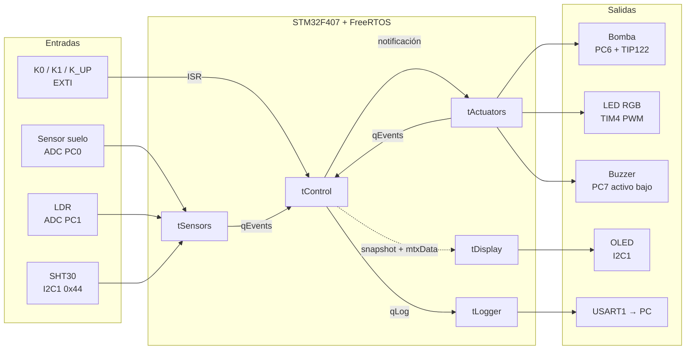
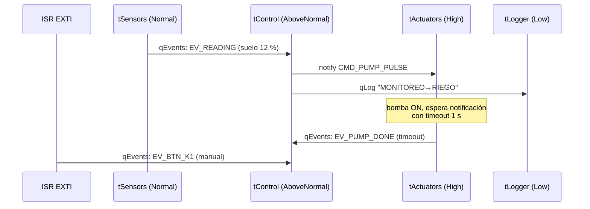
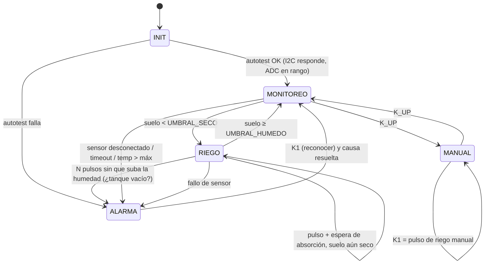

# Arquitectura de software — Mata

> [!resumen]
> 5 tareas de aplicación (CMSIS-RTOS v2 sobre FreeRTOS), 5 niveles de prioridad. La tarea **Control** es la única dueña de la máquina de estados y recibe *todo* por una sola cola de eventos. **Actuadores** recibe órdenes por notificación de tarea y corta la bomba por su cuenta aunque Control falle. El bus I²C se protege con un mutex; la UART tiene un único dueño (Logger), así que no lo necesita.

---

## 1. Diagrama de bloques



---

## 2. Tareas

| Tarea | Responsabilidad | Prioridad (CMSIS) | Activación | Pila (palabras) | Recursos compartidos |
|---|---|---|---|---|---|
| `tActuators` | Encender/apagar bomba con **tiempo máximo**; patrones de buzzer; color del LED RGB según estado | `osPriorityHigh` | Evento: notificación desde `tControl`. Timeout de la espera = fin del pulso de riego | 128 | GPIO PC6/PC7, TIM4 (solo ella) |
| `tControl` | Máquina de estados, umbrales con histéresis, detección de errores, decide riego | `osPriorityAboveNormal` | Evento: `qEvents` (lecturas, botones, fin de riego). Timeout 1 s para detectar sensores mudos | 256 | escribe `g_snapshot` (mtxData) |
| `tSensors` | Leer ADC (suelo, LDR) con promedio, leer SHT30 (con CRC), validar rangos | `osPriorityNormal` | Periódica **500 ms** (`osDelayUntil`); SHT30 cada 4 ciclos (2 s) | 256 | I2C1 (mtxI2C) |
| `tDisplay` | Dibujar pantallas en la OLED | `osPriorityBelowNormal` | Periódica **250 ms** | 384 | I2C1 (mtxI2C), lee `g_snapshot` (mtxData) |
| `tLogger` | Único escritor de la UART: mensajes y telemetría | `osPriorityLow` | Evento: `qLog` | 384 | USART1 (exclusiva) |

**5 niveles distintos** (High > AboveNormal > Normal > BelowNormal > Low); el mínimo exigido es 3.

### Justificación de prioridades (urgencia ↔ consecuencia de llegar tarde)
- **tActuators — la más alta.** Si apaga tarde la bomba, se inunda la matera. Su trabajo es corto (cambiar un pin), así que no roba CPU. Además corta la bomba por *timeout propio*: aunque Control se cuelgue, la bomba no queda encendida.
- **tControl — alta.** Debe reaccionar a botones y a lecturas en < 50 ms para que la interfaz se sienta inmediata y para mandar el apagado a tiempo. Trabajo acotado (una transición por evento).
- **tSensors — media.** La humedad del suelo cambia en minutos; un retraso de decenas de ms es irrelevante, pero el periodo debe ser estable para promediar bien.
- **tDisplay — baja.** Solo estética; si refresca 100 ms tarde nadie lo nota. Es la tarea más larga (≈25 ms de I²C por cuadro), por eso no debe bloquear a las demás.
- **tLogger — la más baja.** La telemetría puede salir tarde sin consecuencias; la cola absorbe ráfagas.

### Verificación de pila
- `configCHECK_FOR_STACK_OVERFLOW = 2` + `vApplicationStackOverflowHook()` → LED rojo fijo + mensaje.
- Cada tarea reporta `uxTaskGetStackHighWaterMark(NULL)` al logger cada 10 s (comando o modo debug). Criterio: **≥ 25 % libre** después de la prueba de 5 min. Documentar los valores medidos en la tabla final.
- Regla: nada de buffers grandes en pila (framebuffer OLED de 1 KB es `static` global).

---

## 3. Comunicación y sincronización

| Objeto | Tipo | Productores → Consumidor | Dato | Por qué este mecanismo |
|---|---|---|---|---|
| `qEvents` | Cola, 8 × `app_event_t` | tSensors, tActuators, ISR botones → **tControl** | lectura nueva, botón, fin de riego, fallo | Varios productores, un consumidor; serializa todo lo que cambia el estado → la máquina de estados no necesita locks. ISR-safe (`osMessageQueuePut` con timeout 0). |
| notificación de `tActuators` | Task notification (valor = comando) | **tControl** → tActuators | `CMD_PUMP_PULSE`, `CMD_PUMP_STOP`, `CMD_BEEP`, `CMD_LED_STATE` | Un solo consumidor conocido; más rápida y liviana que una cola. El timeout de la espera sirve como temporizador del pulso. |
| `qLog` | Cola, 16 × `log_msg_t` (64 B) | todas → **tLogger** | texto con timestamp | Desacopla: nadie se bloquea esperando la UART. |
| `mtxI2C` | Mutex (herencia de prioridad) | tSensors, tDisplay | acceso al bus I2C1 | Dos tareas usan el mismo bus; una transacción a medias corrompe ambas. Mutex (no semáforo) por la herencia de prioridad. |
| `mtxData` | Mutex | tControl (escribe), tDisplay y tLogger (leen) | `g_snapshot` (estado + últimas lecturas) | Estructura de varios campos: sin protección la pantalla podría mostrar mezcla de lecturas viejas y nuevas. |
| sem. DMA UART | Notificación desde `HAL_UART_TxCpltCallback` | ISR → tLogger | fin de transmisión | El logger se **bloquea** mientras el DMA envía (no hay espera activa). |



### Tipos compartidos (`App/Inc/app_types.h`)
```c
typedef enum { ST_INIT, ST_MONITOR, ST_IRRIGATE, ST_MANUAL, ST_ALARM } sys_state_t;

typedef enum {
  EV_READING, EV_SENSOR_FAULT, EV_PUMP_DONE,
  EV_BTN_K0, EV_BTN_K1, EV_BTN_KUP, EV_BTN_KUP_LONG
} event_type_t;

typedef struct {
  int16_t  soil_pct;      /* 0..100, -1 = inválido */
  int16_t  light_pct;     /* 0..100 */
  int16_t  temp_cC;       /* centésimas de °C (evita printf de float) */
  int16_t  hum_cPct;      /* centésimas de %HR */
  uint8_t  valid_mask;    /* bit0 suelo, bit1 luz, bit2 aire */
} readings_t;

typedef struct {
  event_type_t type;
  uint32_t     tick;      /* osKernelGetTickCount() al crear el evento */
  union { readings_t r; uint8_t fault_code; } data;
} app_event_t;
```
Cambiar estos tipos = avisar a la pareja (ver [[CLAUDE]]).

---

## 4. Máquina de estados (tControl)



| Estado | LED RGB | Buzzer | Bomba |
|---|---|---|---|
| INIT | blanco | 1 bip | off |
| MONITOREO | verde | — | off |
| RIEGO | azul (respira con PWM) | — | pulsos |
| MANUAL | ámbar | — | solo con K1 |
| ALARMA | rojo parpadeando | bip cada 2 s | **off forzado** |

### Parámetros (en `App/Inc/app_config.h`, valores de demo)
| Parámetro | Demo | Real | Nota |
|---|---|---|---|
| `SOIL_DRY_PCT` | 15 % | 15 % | entra a RIEGO (el jade se riega con el sustrato casi seco) |
| `SOIL_WET_PCT` | 35 % | 35 % | sale de RIEGO (histéresis; más alto encharca una suculenta) |
| `PUMP_PULSE_MS` | 1 000 | 1 000 | ≈30 ml por pulso; tiempo máximo de bomba encendida por pulso |
| `SOAK_MS` | 15 000 | 30 min | espera para que el agua se absorba (sustrato de cactus drena rápido pero la planta bebe poco) |
| `MAX_PULSES_NO_RISE` | 3 | 3 | → alarma "sin agua" |
| `SENSOR_TIMEOUT_MS` | 3 000 | 3 000 | sin lecturas → alarma |
| `TEMP_MAX_cC` | 3500 | 3500 | sobrecalentamiento |

### Errores previsibles (requisito 4.7)
| Error | Detección | Reacción |
|---|---|---|
| Sensor de suelo desconectado | ADC < `SOIL_RAW_MIN` (pull-down 100 kΩ lleva el pin a 0) | ALARMA, bomba bloqueada |
| SHT30 no responde o CRC inválido | HAL_I2C ≠ HAL_OK o CRC-8 incorrecto, 3 veces seguidas | ALARMA "aire" (el riego puede seguir, decidir) |
| tSensors deja de reportar | `qEvents` vacía > `SENSOR_TIMEOUT_MS` (timeout de la espera) | ALARMA "timeout" |
| Tanque vacío / bomba dañada | N pulsos sin subir la humedad | ALARMA "sin agua" |
| Bomba encendida demasiado | timeout propio en tActuators | se apaga sí o sí |
| Botón con rebote | antirrebote por tiempo en ISR (ignora < 50 ms) + pulsación larga ≥ 1 s | — |
| Lectura fuera de rango físico | temp < -10 / > 60 °C, HR > 100 % | se descarta, cuenta como fallo |

---

## 5. Demostración de preempción (sección 6.4)

**Escenario:** `tDisplay` (BelowNormal) está enviando un cuadro completo a la OLED (~25 ms de I²C, trabajo no instantáneo). Se presiona K1 → la ISR pone `EV_BTN_K1` en `qEvents` → `tControl` (AboveNormal) pasa de **bloqueada** a **lista**, y como tiene más prioridad que la que se ejecuta, el scheduler la pone a **ejecutar** inmediatamente (en la salida de la ISR, `portYIELD_FROM_ISR`). Control notifica a `tActuators` (High), que a su vez desaloja a Control, enciende la bomba y se bloquea. Luego Control termina y solo entonces Display continúa su cuadro.

**Evidencia (dos vías):**
1. **Analizador lógico:** cada tarea pone su pin de traza (PE7–PE11) en alto al entrar y bajo al salir, usando los hooks `traceTASK_SWITCHED_IN/OUT` en `FreeRTOSConfig.h` (sección USER CODE). En PulseView se ve el pulso de Display cortado por Control y Actuators.
2. **UART:** cada evento lleva `tick` (y opcionalmente ciclos DWT). El log muestra `DSP frame start t=…`, `CTL EV_BTN_K1 t=…`, `ACT pump ON t=…`, `DSP frame end t=…` con los tiempos de Control/Actuators **dentro** del intervalo de Display.

> **Estados de tarea:** *ejecutándose* = la que tiene la CPU; *lista* = podría correr pero hay otra de igual o mayor prioridad corriendo; *bloqueada* = esperando un retardo (`osDelayUntil`) o un evento (cola, notificación, mutex) → **no consume CPU**. Entre tareas listas de igual prioridad hay *round-robin* por tick (1 ms); con distinta prioridad siempre corre la de mayor.

---

## 6. Organización del código

```
firmware/brote/                 ← proyecto STM32CubeIDE (nombre provisional)
├── brote.ioc                   ← CubeMX: reloj, pines, periféricos, tareas, colas, mutex
├── Core/                       ← generado por CubeMX; solo tocar dentro de USER CODE
│   ├── Inc/ FreeRTOSConfig.h, main.h, ...
│   └── Src/ main.c, freertos.c, stm32f4xx_it.c, ...
├── App/                        ← NUESTRO código (CubeMX nunca lo toca)
│   ├── Inc/ app_config.h, app_types.h, app_shared.h, task_*.h, drv_*.h
│   └── Src/
│       ├── task_sensors.c  task_control.c  task_actuators.c  task_display.c  task_logger.c
│       ├── state_machine.c       ← lógica pura de transiciones (sin HAL → fácil de probar)
│       ├── drv_sht30.c  drv_ssd1306.c  font_6x8.c
│       ├── drv_analog.c          ← ADC suelo + LDR, calibración
│       └── drv_outputs.c         ← bomba, buzzer, RGB, pines de traza
├── Drivers/  Middlewares/      ← HAL y FreeRTOS de ST, no se editan
```

- Las tareas se declaran en CubeMX con **"Code Generation Option: As weak"**; CubeMX genera `__weak void StartSensorsTask(void *argument)` en `freertos.c` y nosotros damos la definición real en `App/Src/task_sensors.c`. Así el `.ioc` documenta prioridades/pilas y el código vive fuera de lo generado.
- **Lectura del SHT30:** comando de medida única *sin clock stretching* `0x2400` → **soltar `mtxI2C`** → `osDelay(20)` → tomar mutex → leer 6 bytes (T, CRC, HR, CRC) → soltar. Así no se duerme con el mutex tomado y la OLED puede usar el bus durante la conversión. CRC-8 polinomio 0x31, init 0xFF. Conversión en punto fijo: `temp_cC = -4500 + 17500*raw_t/65535`, `hum_cPct = 10000*raw_h/65535` (usar aritmética de 32 bits).
- Capas: `task_*` (lógica RTOS) → `drv_*` (usa HAL) → HAL. Las tareas no llaman HAL directamente salvo casos triviales.

---

## 7. Configuración CubeMX (checklist)

- **RCC:** HSE = Crystal (8 MHz), LSE opcional. **Clock:** PLL → SYSCLK 168 MHz, AHB 168, APB1 42, APB2 84.
- **SYS:** Debug = **Serial Wire** (si no, se pierde el ST-Link). Timebase Source = **TIM6** (SysTick queda para FreeRTOS).
- **FREERTOS:** CMSIS_V2. `USE_NEWLIB_REENTRANT = Enabled`. Heap_4, `TOTAL_HEAP_SIZE = 32768`. `CHECK_FOR_STACK_OVERFLOW = Option2`. `USE_TRACE_FACILITY = 1`, `INCLUDE_uxTaskGetStackHighWaterMark = 1`. Tareas, colas y mutex de las tablas anteriores (tareas *As weak*).
- **ADC1:** IN10 (PC0), IN11 (PC1), 12 bits, sample time **480 ciclos** (fuentes de alta impedancia), conversión simple por software.
- **I2C1:** PB6/PB7, Fast Mode 400 kHz.
- **TIM4:** CH1–CH3 PWM en PD12–PD14, ~1 kHz, ARR = 999.
- **USART1:** PA9/PA10 115200 8N1, **DMA TX** (DMA2 Stream7), interrupción global habilitada.
- **GPIO:** PC6, PC7, PE7–PE11 salida; PA6/PA7 salida (inician en alto = LED apagado); PE3/PE4 EXTI falling + pull-up; PA0 EXTI rising + pull-down.
- **NVIC:** EXTI0, EXTI3, EXTI4, USART1, DMA con prioridad **≥ 5** (numérica) y marcados "Uses FreeRTOS functions".
- **Project Manager:** "Generate peripheral initialization as a pair of .c/.h files" = sí. Toolchain STM32CubeIDE.

---

## Enlaces
- [[propuesta]] · [[enunciado]] · [[CLAUDE]]
