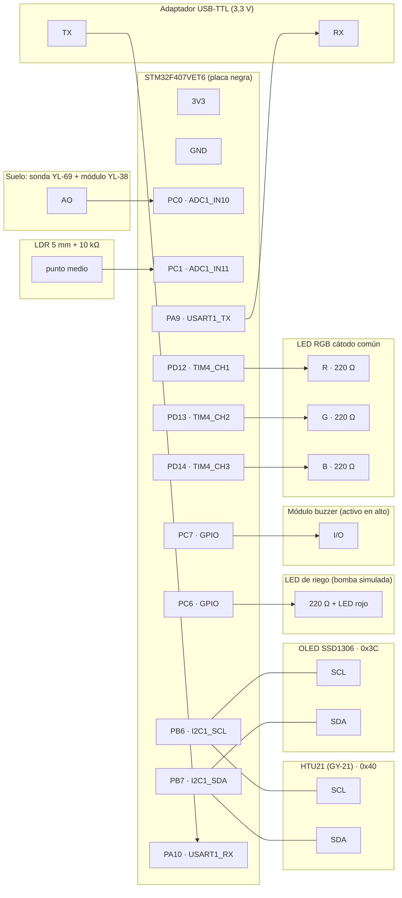

# Diagrama de cableado — Brote

Sale de la tabla de pines de [[propuesta]] §3 (esa tabla sigue siendo la fuente de verdad: si cambia un pin, se cambia allá y aquí). Placa: STM32F407VET6 "negra" (STM32_F4VE); su esquemático está en `docs/datasheets/stm32f407vet6_schematics.pdf`.

> [!warning] Antes de energizar
> - **Todo a 3V3**, nada a 5 V: ni el sensor de suelo, ni el buzzer, ni la OLED.
> - Revisar el **orden de VCC y GND** en la serigrafía de la OLED y del GY-21: cambia entre fabricantes y, si se invierte, el módulo se quema.
> - Ningún LED sin su resistencia de 220 Ω.
> - Cablear con la placa **desconectada** del USB y del ST-Link.

## 1. Vista general



Alimentación (no se dibuja en el diagrama para no enredarlo): **3V3 y GND de la placa van a los rieles de la protoboard**, y de ahí a cada módulo según la tabla de abajo.

## 2. Conexión por conexión

Marcar cada fila al cablearla.

### Rieles de la protoboard
| ✔ | De | A |
|---|---|---|
| ☐ | 3V3 de la placa | riel **+** de la protoboard |
| ☐ | GND de la placa | riel **−** de la protoboard |

### Sensor de suelo (YL-69 + YL-38) → PC0
| ✔ | De | A | Nota |
|---|---|---|---|
| ☐ | Sonda YL-69 (2 pines) | Módulo YL-38, bornes de 2 pines | sin polaridad |
| ☐ | YL-38 **VCC** | riel + (3V3) | no a 5 V |
| ☐ | YL-38 **GND** | riel − | |
| ☐ | YL-38 **AO** | **PC0** | la salida DO no se usa |
| ☐ | Resistencia **100 kΩ** | entre **PC0** y riel − | pull-down: detecta el cable AO suelto |

### LDR → PC1
```
 3V3 ──[ LDR ]──┬──[ 10 kΩ ]── GND
                │
               PC1
```
| ✔ | De | A | Nota |
|---|---|---|---|
| ☐ | LDR, una pata | riel + (3V3) | sin polaridad |
| ☐ | LDR, otra pata | **PC1** | punto medio del divisor |
| ☐ | Resistencia **10 kΩ** | entre **PC1** y riel − | más luz = más voltaje en PC1 |

### HTU21 (GY-21) y OLED → I2C1 (mismo bus)
| ✔ | De | A | Nota |
|---|---|---|---|
| ☐ | GY-21 **VIN** | riel + (3V3) | |
| ☐ | GY-21 **GND** | riel − | |
| ☐ | GY-21 **SCL** | **PB6** | |
| ☐ | GY-21 **SDA** | **PB7** | |
| ☐ | OLED **VCC** | riel + (3V3) | revisar la serigrafía |
| ☐ | OLED **GND** | riel − | revisar la serigrafía |
| ☐ | OLED **SCL** | **PB6** | comparte la línea con el GY-21 |
| ☐ | OLED **SDA** | **PB7** | comparte la línea con el GY-21 |

Los dos módulos traen sus resistencias de pull-up: no hay que añadir ninguna.

### LED de riego → PC6
```
 PC6 ──[220 Ω]──▶|── GND      (pata larga = ánodo, hacia la resistencia)
```
| ✔ | De | A | Nota |
|---|---|---|---|
| ☐ | **PC6** | resistencia **220 Ω** | |
| ☐ | Resistencia 220 Ω | **ánodo** del LED rojo (pata larga) | |
| ☐ | **Cátodo** del LED (pata corta) | riel − | encendido = "regando" |

### Módulo buzzer → PC7
| ✔ | De | A | Nota |
|---|---|---|---|
| ☐ | Buzzer **VCC** | riel + (3V3) | **no a 5 V**: no se apagaría nunca |
| ☐ | Buzzer **GND** | riel − | |
| ☐ | Buzzer **I/O** | **PC7** | suena con el pin en bajo |

### LED RGB cátodo común → PD12 / PD13 / PD14
| ✔ | De | A | Nota |
|---|---|---|---|
| ☐ | **PD12** | 220 Ω → pata **R** | TIM4_CH1 |
| ☐ | **PD13** | 220 Ω → pata **G** | TIM4_CH2 |
| ☐ | **PD14** | 220 Ω → pata **B** | TIM4_CH3 |
| ☐ | Pata **común** (la más larga) | riel − | cátodo común |

### Adaptador USB-TTL → USART1 (telemetría)
| ✔ | De | A | Nota |
|---|---|---|---|
| ☐ | **PA9** (TX de la placa) | **RX** del adaptador | cruzado |
| ☐ | **PA10** (RX de la placa) | **TX** del adaptador | cruzado |
| ☐ | GND de la placa | **GND** del adaptador | obligatorio |
| — | VCC del adaptador | **no conectar** | la placa ya está alimentada |

Monitor serie a 115200 8N1. Adaptador con el jumper en 3,3 V.

### ST-Link (programar y depurar)
| ✔ | De | A |
|---|---|---|
| ☐ | SWDIO | PA13 |
| ☐ | SWCLK | PA14 |
| ☐ | GND | GND |
| ☐ | 3V3 | 3V3 (si la placa no se alimenta por USB) |

Van en el conector JTAG de 20 pines de la placa.

## 3. Ya vienen en la placa (no se cablean)
| Elemento | Pin | Uso |
|---|---|---|
| Botón K0 | PE4 | cambiar de pantalla |
| Botón K1 | PE3 | riego manual / reconocer alarma |
| Botón K_UP | PA0 | MONITOREO ⇄ MANUAL |
| LEDs D2 / D3 | PA6 / PA7 | activos en bajo |

## 4. Opcional
- **Analizador lógico (no se usa):** PE7–PE11 quedaron reservados como pines de traza, pero el firmware no los escribe.

## 5. Lista de resistencias
| Valor | Cantidad | Dónde |
|---|---|---|
| 220 Ω | 4 | LED de riego (1) y LED RGB (3) |
| 10 kΩ | 1 | divisor de la LDR |
| 100 kΩ | 1 | pull-down de PC0 |

La segunda de 100 kΩ de la lista de compras no hace falta en PC1: la de 10 kΩ del divisor ya lleva ese pin a GND.

## Enlaces
- [[propuesta]] · [[arquitectura]] · [[bom]] · [[pruebas]]
